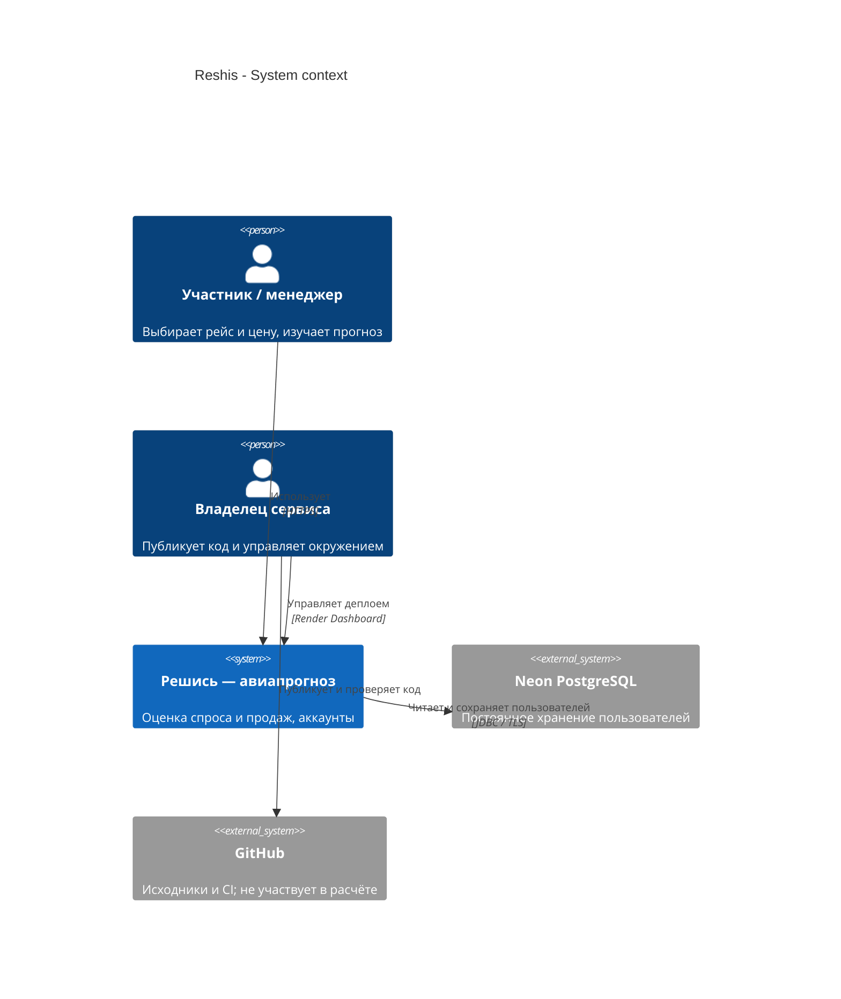
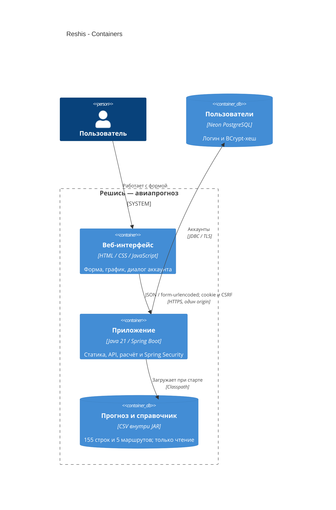
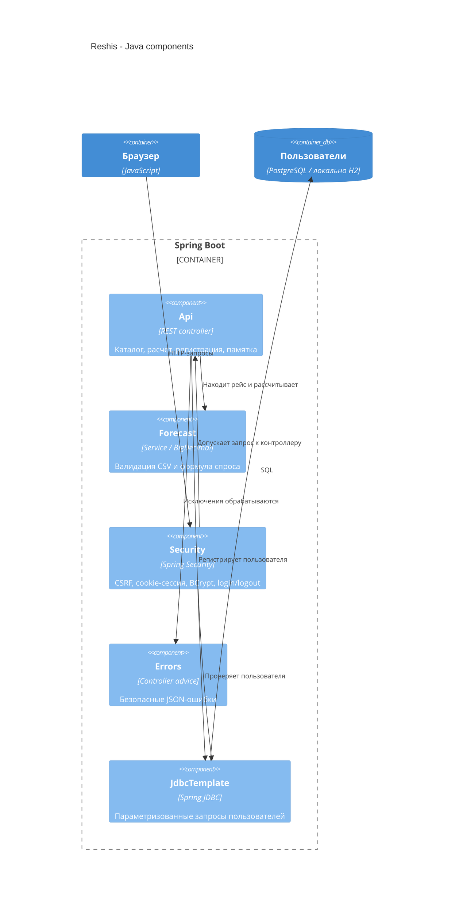
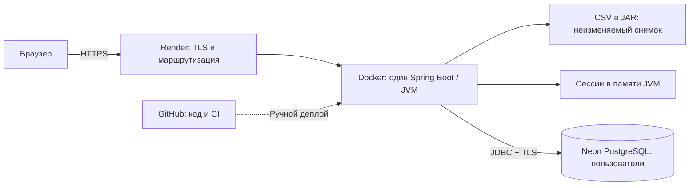

# C4: контекст, контейнеры, компоненты и размещение

Диаграммы описывают опубликованный срез c1a81820cb96. Исходники диаграмм — блоки Mermaid в этом файле; GitHub отображает их непосредственно. Runtime остаётся одним Java-сервисом. Стрелки показывают зависимости и передачу данных, а не микросервисы.

## C1 — контекст

## C2 — контейнеры

CSV здесь выделен для объяснения хранения; это ресурс того же приложения, а не отдельный сетевой сервис. PostgreSQL показан вне границы управляемого Java-приложения как внешний провайдер.

## C3 — компоненты Java-приложения

В этом срезе регистрация и создание таблицы находятся в Api. Выделенные Accounts и SchemaMigrations относятся к последующим локальным изменениям.

## Размещение и сроки жизни данных

Перезапуск JVM завершает сессии; пользователи остаются во внешней БД. Файловая система бесплатного контейнера не используется для постоянных аккаунтов. Локально используется H2 file. Горизонтальное масштабирование потребовало бы отдельного решения для сессий; оно здесь не заявляется.
