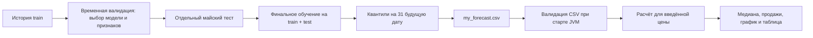

# Данные, модель и расчёт

## Происхождение

Приложение читает `src/main/resources/data/my_forecast.csv` и `routes.csv`. Обучение выполнено отдельно в ML-ноутбуке: AutoGluon TimeSeries, DirectTabular с LightGBM и календарными признаками. Python, обучение и загрузка весов не выполняются при HTTP-запросе.

Прогноз: 5 направлений, 31 дата с 01.06.2026 по 01.07.2026 включительно, 155 строк, 30 колонок. Ключ — `(route, date)`. SHA-256: `154f3c8d587eb9ae70aa5cdd7c2d8d5133139511337755ab544e04a49d8f8b4c`. [Манифест происхождения](data-provenance.json).

## Поля

| Источник | Содержание |
|---|---|
| routes.csv | route, name, base_price, cost_per_passenger, price_sensitivity, price_min, price_max |
| my_forecast.csv | route, date, seats и девять троек X_base_demand / X_price / X_price_demand |

Цена — рубли; чувствительность — пассажиры на рубль. `seats` берётся из конкретной строки расписания, а не из вместимости 150 из отдельной аналитической части. Прогноз включает оценочные, в том числе дробные значения; их нельзя считать проданными билетами бронирования.

## Формула

Для каждого квантиля q:

```text
demand(q, price) = base_demand(q) - price_sensitivity * (price - base_price)
sales = min(seats, max(0, demand(0.5, price)))
```

BigDecimal сохраняет десятичную арифметику. Округление до двух знаков относится к представлению в интерфейсе. Спрос не обрезается по seats; отрицательный результат означает выход линейной учебной модели за физический диапазон, продажи при этом равны нулю. Рекомендованный диапазон цен допускает отклонение с предупреждением.

Пример Москва → Сочи, 01.06.2026: base_price=9000, median=854, sensitivity=0.141, seats=900. При 8000 руб. спрос 995, продажи 900. При 10000 руб. спрос 713, продажи 713.

## Путь данных



## Проверки и ограничения

При старте проверяются схема, числовые значения, пять маршрутов, 155 строк, даты, положительные seats и уникальность ключей; повреждение данных останавливает приложение. Подстановка seasonal_forecast не используется.

MAE валидации 36,87158 пассажира; отдельного теста 63,41574. По известному тесту модель не подбиралась повторно. Квантили — уровни одного модельного прогноза, не девять независимых равновероятных исходов. Фактическое покрытие на неизвестном будущем не гарантировано. Прогноз не доказывает прирост реальной прибыли; нужны новые периоды, мониторинг и оценка чувствительности экономических решений.

Обновление CSV требует повторной валидации, сборки и деплоя. UI не редактирует прогноз и не переобучает модель.
