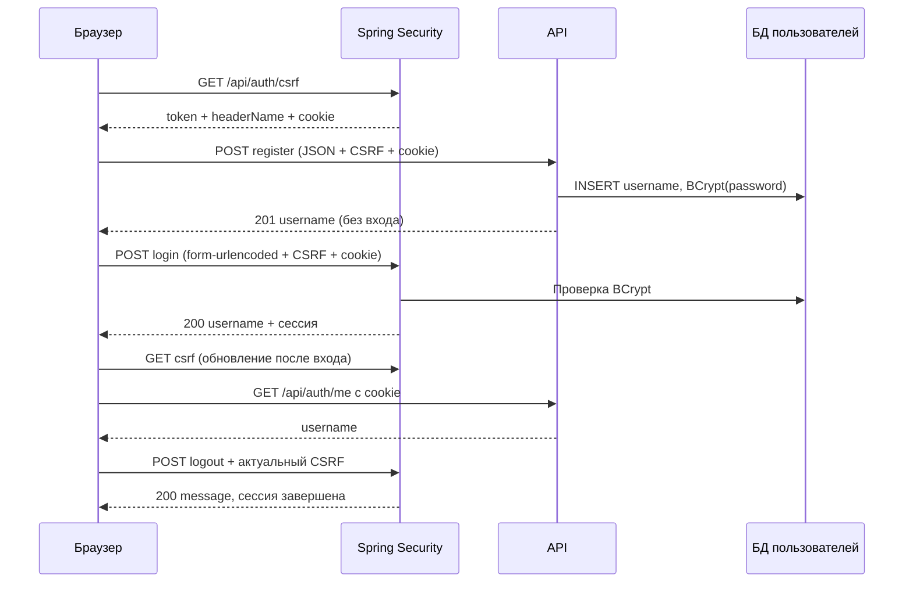

# Интеграция и сценарии API

[Машиночитаемый OpenAPI 3.1](openapi.json). Файл статический: наличие `/swagger-ui` или `/v3/api-docs` не заявляется.

## Публичный расчёт из PowerShell

```powershell
$base = 'https://aviaprognoz.onrender.com'
$session = New-Object Microsoft.PowerShell.Commands.WebRequestSession
$csrf = Invoke-RestMethod "$base/api/auth/csrf" -WebSession $session
$headers = @{}; $headers[$csrf.headerName] = $csrf.token
$body = @{route='MOW-AER'; date='2026-06-01'; price=9000} | ConvertTo-Json
Invoke-RestMethod "$base/api/calculate" -Method Post -WebSession $session -Headers $headers -ContentType 'application/json' -Body $body
```

Cookie и токен должны относиться к одной сессии. Число price передаётся JSON number, не строкой. Дата строго ISO и должна быть в каталоге. Сначала можно получить `/api/catalog`; вымышленных маршрутов или текущей даты в данных нет.

## Вход



## Интерпретация ответов

| Статус | Действие клиента |
|---|---|
| 400 | Исправить типы, поля, цену или дату; не повторять автоматически |
| 401 | Проверить вход / пароль; не считать это сетевой ошибкой |
| 403 | Проверить cookie и актуальный CSRF; обновить токен, не выполнять бесконечный повтор |
| 404 | Выбрать существующий рейс из каталога |
| 409 | Выбрать другой логин |
| 500 | Показать безопасное сообщение, проверить сервис и логи |

Публичный расчёт не изменяет расписание или продажи. Повтор регистрации не идемпотентен: второй запрос с тем же логином возвращает 409. После изменения параметров старый результат UI помечается устаревшим.
